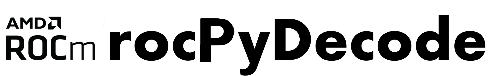

# rocPyDecode

rocPyDecode provides Python bindings for AMD's rocDecode and rocJPEG libraries:

- [`videoDecode`](videoDecode/README.md): GPU video decoding and PyAV container demuxing.
- [`jpegDecode`](jpegDecode/README.md): GPU JPEG decoding.

Build both from the repository root, or build either component independently.
Building and installing do not require a GPU. Decoding and runtime tests require
supported AMD hardware and compatible ROCm libraries.

## Documentation

- [Prerequisites](docs/install/rocPyDecode-prerequisites.rst)
- [Installation and installed-package tests](docs/install/rocPyDecode-install.rst)
- [Build from source and select GPU targets](docs/install/rocPyDecode-cmake-install.rst)
- [Samples](docs/tutorials/rocPyDecode-samples.rst)
- [Video API](docs/reference/rocPyDecode.rst) and [JPEG API](docs/reference/rocPyJPEGDecode-api.rst)

The documentation source is maintained in [`docs/`](docs/index.rst).
[Published documentation](https://rocm.docs.amd.com/projects/rocPyDecode/en/latest/)
is available on the ROCm documentation site.
